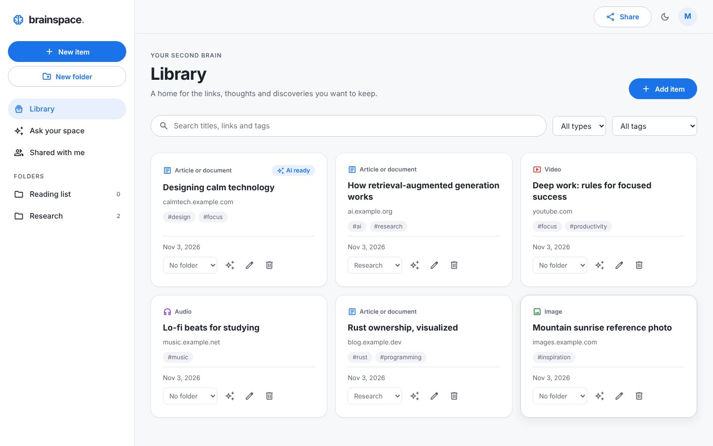
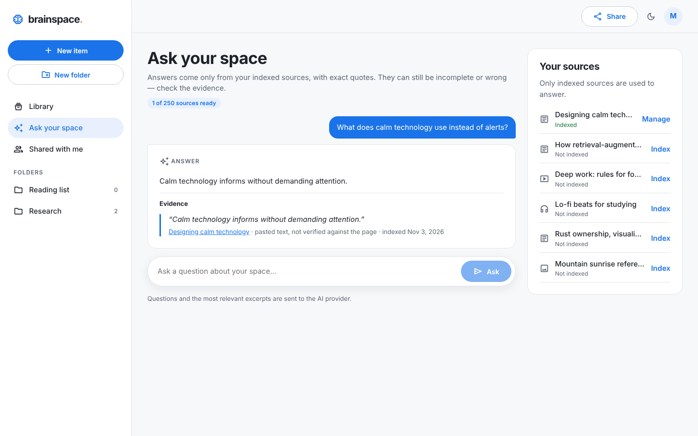
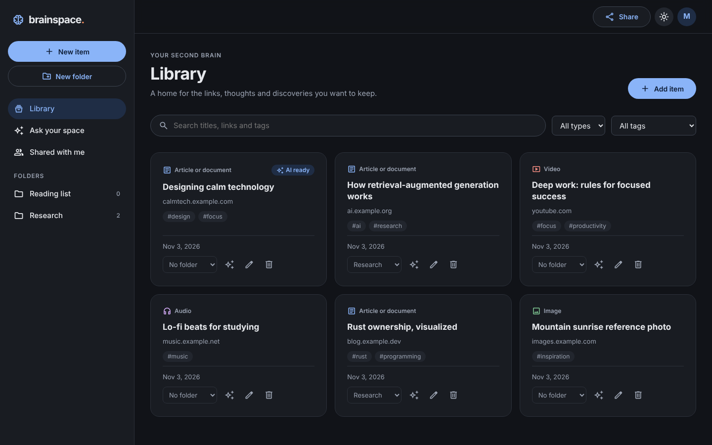
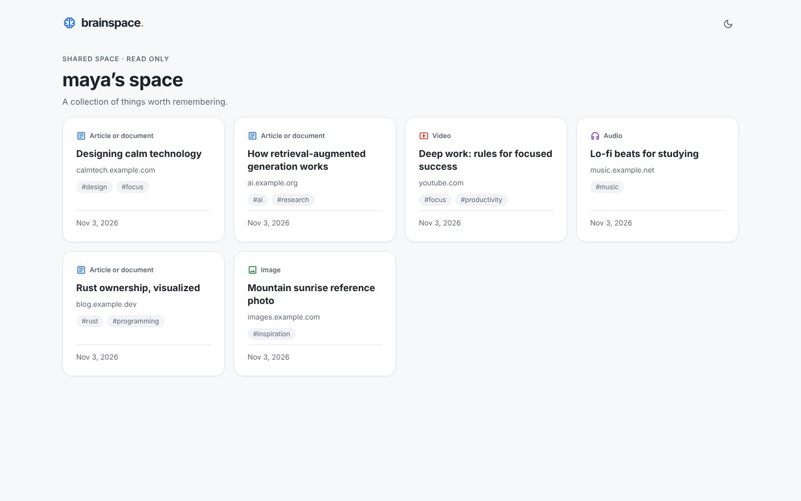
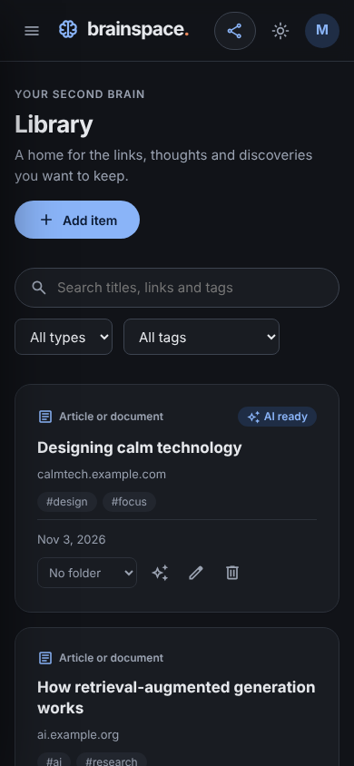

# BrainSpace 2

A calm, personal **second brain**: save the links worth keeping — articles, documents, videos, audio
and images — find them again in seconds, share a read-only view with people you trust, and ask
questions across your sources with answers that quote their evidence.

BrainSpace 2 is a from-scratch, production-grade rebuild of [BrainSpace](https://github.com/HarshShrestha/BrainSpace)
on the same stack, with layered modules, explicit API contracts, validated configuration, tests at
every level, and deployable container images.

| Library | Assistant |
| --- | --- |
|  |  |

<details><summary>Dark mode, mobile and public share views</summary>





</details>

Screenshots show sample data, and the assistant uses the test-only provider stub.

## Features

- **Accounts:** register, sign in, sign out everywhere, change password, delete the account with all its data.
- **Library:** save http(s) links with a type and tags; server-side search over titles, links and tags; filter by type, tag and folder; edit, move and delete; cursor pagination.
- **Folders:** create, rename and delete (only when empty), with item counts.
- **Sharing:** one revocable, rotatable read-only link to your space; save links others share with you under **Shared with me**.
- **AI assistant (optional):** index chosen sources with explicit consent (pasted text or a safely fetched public page), then ask questions. Answers cite verbatim quotes, and the assistant abstains when evidence is weak.
- **Experience:** responsive layout, light/dark theme, keyboard- and screen-reader-friendly dialogs and forms, and loading, empty and error states everywhere.

## Stack

| Layer | Technology |
| --- | --- |
| Web | React 18, TypeScript, Vite 7, Recoil, React Router 7, Zod |
| API | Node.js 22, Express 5, TypeScript, Mongoose 9 (MongoDB), Zod, JWT + bcrypt, Helmet, pino |
| AI worker | Python 3.10+ (standard library only), Google Gemini |
| Quality | Vitest, Testing Library, Supertest, Playwright, ESLint, Prettier |
| Delivery | Docker (non-root images), NGINX, Docker Compose, GitHub Actions, Dependabot |

## Quick start

**With Docker** (production-like, on http://localhost:8080):

```bash
JWT_SECRET=$(openssl rand -hex 32) docker compose up --build
```

**For development** (Node 22.12+, Python 3.10+, a MongoDB instance):

```bash
npm run install:all
cp backend/.env.example backend/.env    # set MONGODB_URI and JWT_SECRET
npm run dev:api                         # API on :8000
npm run dev:web                         # web on :5173 (proxies /api)
```

To enable the assistant, set `RAG_ENABLED=true` and `GEMINI_API_KEY` in `backend/.env`. See
[docs/08_AI_ASSISTANT.md](docs/08_AI_ASSISTANT.md).

## Quality checks

```bash
npm run lint && npm run typecheck && npm test   # 145 unit, integration, Python and component tests
npm run build && E2E_MONGODB_URI=mongodb://127.0.0.1:27017 npm run test:e2e   # 6 browser journeys
```

## Repository layout

```
backend/    Express API — config · models · validators · middleware · controllers · services · routes
frontend/   React app  — components · features · hooks · layouts · pages · routes · services · store
rag/        Python AI worker (subprocess, no network listener)
e2e/        Playwright end-to-end journeys
docs/       Design documents (start here)
```

## Documentation

| # | Document | Read it to… |
| --- | --- | --- |
| 01 | [Product requirements](docs/01_PRODUCT_REQUIREMENTS.md) | understand what the product does and doesn't do |
| 02 | [System architecture](docs/02_SYSTEM_ARCHITECTURE.md) | know where every piece of code belongs |
| 03 | [API specification](docs/03_API_SPECIFICATION.md) | call or change the HTTP API |
| 04 | [Data model](docs/04_DATA_MODEL.md) | work with collections, indexes and invariants |
| 05 | [Security](docs/05_SECURITY.md) | review threats and controls |
| 06 | [Testing strategy](docs/06_TESTING_STRATEGY.md) | run and write tests |
| 07 | [Deployment & operations](docs/07_DEPLOYMENT_AND_OPERATIONS.md) | configure, deploy, monitor and roll back |
| 08 | [AI assistant](docs/08_AI_ASSISTANT.md) | understand retrieval, safeguards and evaluation |
| 09 | [Development workflow](docs/09_DEVELOPMENT_WORKFLOW.md) | set up, follow conventions and add features |

> **CI activation:** the GitHub Actions pipeline is in `.github/ci/ci.yml`. Move it to
> `.github/workflows/` to enable it (see [.github/ci/README.md](.github/ci/README.md)).
